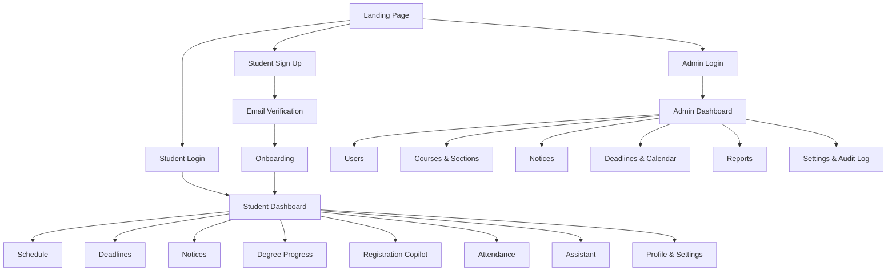
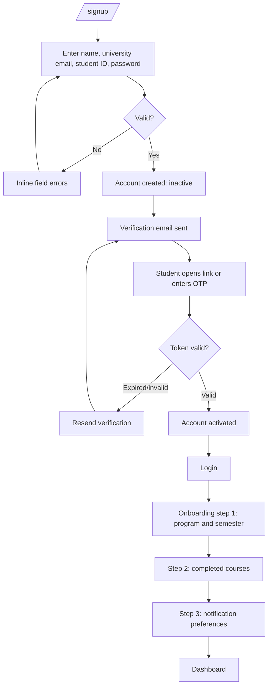
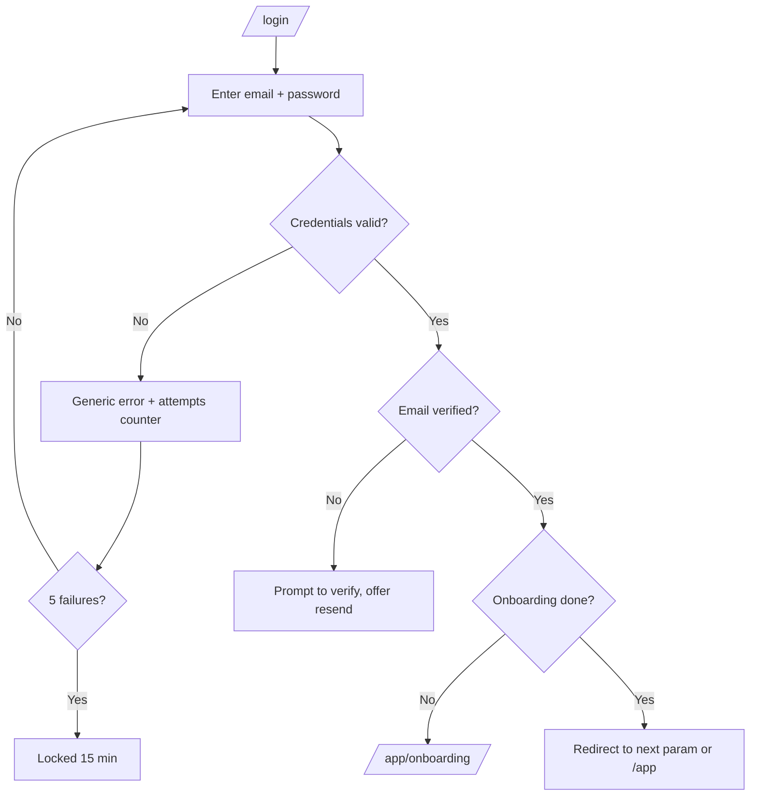
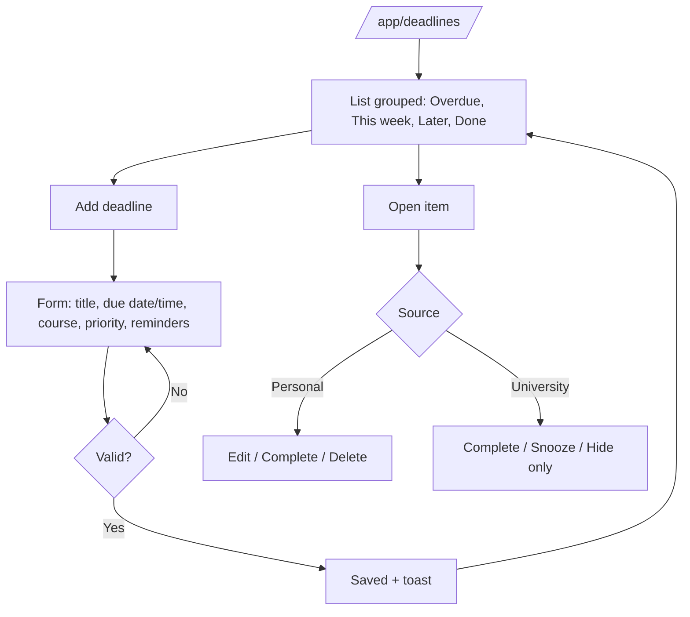
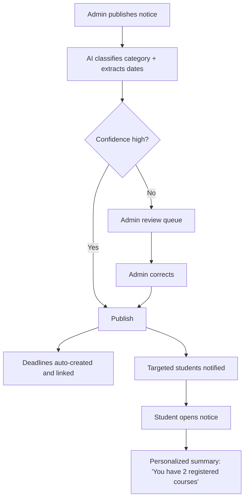
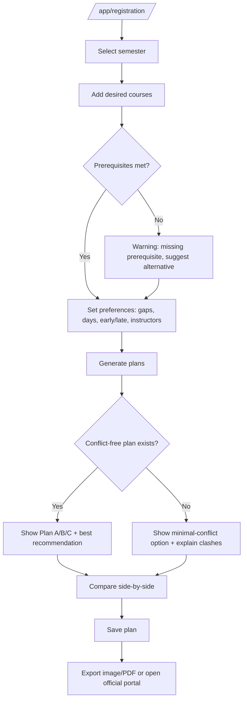
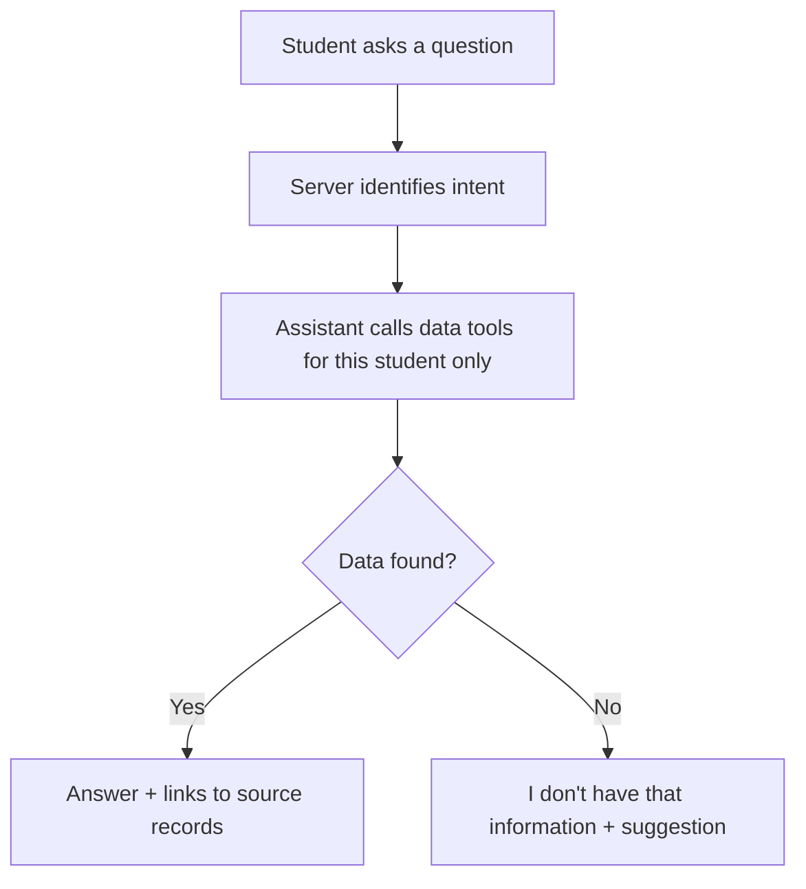
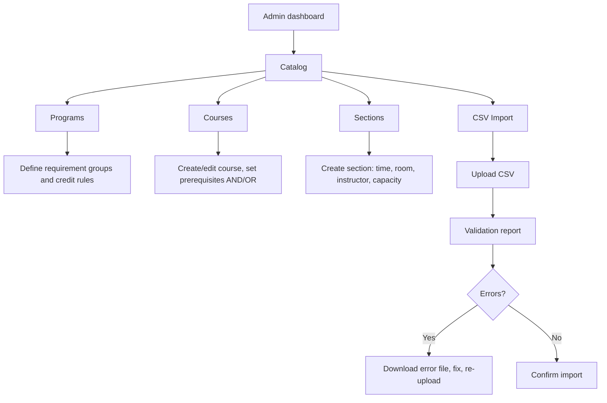
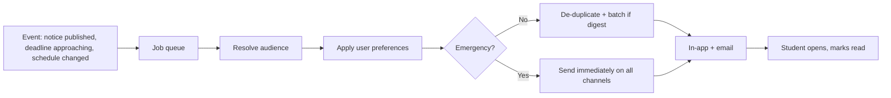

# FRIDAY: App Flow

**Companion to:** `prd.md`, `tech-stack.md`
**Date:** October 21, 2026
**Purpose:** Describe every screen, route, and journey in the student and admin portals, including transitions and UI states.

---

## 1. App Map

---

## 2. Route Table

### 2.1 Public
| Route | Screen | Notes |
|---|---|---|
| `/` | Landing page | Product pitch, links to student sign up / login |
| `/login` | Student login | Email + password, "Forgot password" |
| `/signup` | Student sign up | University email required |
| `/verify` | Email verification | Link or OTP |
| `/forgot-password`, `/reset-password` | Password recovery | Expiring token |
| `/admin/login` | Admin login | Separate credentials, no sign-up link |

### 2.2 Student Portal (auth required, role `student`)
| Route | Screen |
|---|---|
| `/app` | Dashboard |
| `/app/onboarding` | First-time profile setup |
| `/app/schedule` | Weekly schedule + exams |
| `/app/deadlines` | Deadline manager |
| `/app/notices` | Notice board |
| `/app/notices/[id]` | Notice detail |
| `/app/degree` | Degree progress |
| `/app/registration` | Registration Copilot |
| `/app/registration/plans/[id]` | Saved plan detail |
| `/app/attendance` | Attendance tracker |
| `/app/assistant` | AI assistant chat |
| `/app/notifications` | Notification center |
| `/app/profile`, `/app/settings` | Profile and preferences |

### 2.3 Admin Portal (auth required, role `admin` / `super_admin`)
| Route | Screen |
|---|---|
| `/admin` | Admin dashboard |
| `/admin/users` | User list and detail |
| `/admin/catalog/programs` | Programs and degree rules |
| `/admin/catalog/courses` | Courses and prerequisites |
| `/admin/catalog/sections` | Sections (times, rooms, instructors, capacity) |
| `/admin/catalog/import` | CSV import and validation report |
| `/admin/notices` | Notice list, create, review AI extraction |
| `/admin/deadlines` | University deadlines and academic calendar |
| `/admin/reports` | Usage and registration reports |
| `/admin/audit-log` | Admin action history |
| `/admin/settings` | University settings, admin accounts (super-admin) |

### 2.4 Route Guards
| Situation | Behavior |
|---|---|
| Not logged in, visits `/app/*` | Redirect to `/login?next=<original>` |
| Not logged in, visits `/admin/*` | Redirect to `/admin/login` |
| Student visits `/admin/*` | 403 page with link to student dashboard |
| Admin visits `/app/*` | 403 page with link to admin dashboard |
| Logged in, visits `/login` | Redirect to the correct dashboard |
| Session expired | Redirect to login, preserving the `next` path |
| Student with unfinished onboarding | Redirect to `/app/onboarding` |

---

## 3. Authentication Flows

### 3.1 Student Sign Up and Onboarding

**Onboarding steps**
1. **Program and semester:** select program, current semester, intake.
2. **Completed courses:** searchable multi-select with grades; "I'll do this later" allowed (degree and registration features show a prompt until complete).
3. **Notification preferences:** channels and reminder timing (defaults pre-filled).

### 3.2 Student Login

### 3.3 Forgot Password
`/forgot-password` → enter email → always show "If this email exists, a link was sent" → reset link (expiring) → `/reset-password` → new password rules checked → success toast → login.

### 3.4 Admin Login
`/admin/login` → credentials → (optional 2FA in future) → `/admin`. No self-registration; accounts are created by a super-admin, who sends an invite link to set a password.

---

## 4. Student Journeys

### 4.1 Dashboard
**Widgets (top to bottom on mobile):**
1. Greeting + date
2. **Today's classes** (time, course, room, instructor; "No classes today" empty state)
3. **Next deadlines** (top 3, status-colored)
4. **Important notices** (latest unread, category chips)
5. **Attendance alerts** (courses near the threshold)
6. **Degree snapshot** (credits completed/remaining)
7. Quick actions: Add deadline, Plan registration, Ask assistant

**Transitions:** each widget links to its full page; clicking a deadline opens its detail drawer; clicking a notice opens `/app/notices/[id]`.

### 4.2 Schedule
- Toggle: **Week grid** / **List**.
- Overlays: exams (distinct color), university holidays.
- Click a class → side panel with course, section, room, instructor, attendance quick-log.
- **Schedule change flow:** admin edits a section → affected students' schedules update → notification "CSE321 Sec 23 moved to Room 8C" → schedule shows a "changed" badge until viewed.

### 4.3 Deadline Manager

- **Status colors:** 🔴 urgent (≤ 2 days or overdue), 🟡 upcoming (≤ 7 days), 🟢 later, ✅ done.
- **Filters:** source, status, course, due window. **Sort:** due date, priority.
- **Reminder flow:** a job fires at 3 days, 1 day, and 2 hours before → in-app + email notification → tapping opens the deadline.

### 4.4 Notices

- **Board:** search, filter by category (Registration, Exam, Tuition, Scholarship, Holiday, Academic, Administrative, Emergency), unread toggle, sort by newest or importance.
- **Emergency notices:** red banner across the app and immediate delivery regardless of preferences.

### 4.5 Degree Progress
1. Open `/app/degree`.
2. See ring chart: completed / in progress / remaining credits.
3. Expand requirement groups (core, major, electives) to see checked and unchecked courses.
4. Blocked courses show which prerequisite is missing, with a link to add it to a plan.
5. **Incomplete data state:** if completed courses are missing, show a banner "Add your completed courses for accurate progress" → onboarding step 2.
6. *(Release 2)* **What-if:** change credits per semester → graduation estimate recalculates (e.g. "Spring 2029").

### 4.6 Registration Copilot

- **Loading state:** "Checking sections and conflicts…" progress text.
- **Plan card:** sections, times, credits, conflicts count, instructor names, "last updated" timestamp for seat data.
- **Disclaimer:** FRIDAY plans; registration is completed in the official university portal.
- **Failure states:** no sections available → explain and suggest alternatives; stale data → warning banner.

### 4.7 Attendance
- Choose a course → see percentage, required minimum, and "You can miss ~2 more classes".
- Log attended / missed per session (from schedule quick-log or this page).
- **Alert flow:** if upcoming consecutive classes could breach the threshold, show a warning on the dashboard and send a notification.

### 4.8 AI Assistant

- Suggested prompts shown in the empty state ("When is my next class?", "Can I graduate by Spring 2029?").
- Read-only in the MVP; it cannot change data.
- Error state: "Something went wrong, try again" with a retry button; rate-limit message when exceeded.

### 4.9 Notification Center
- Bell icon with unread count in the header.
- List grouped by Today / Earlier; filter by type; mark read / mark all read.
- Each notification deep-links to its item (deadline, notice, schedule change).

### 4.10 Profile and Settings
- Edit profile, program, semester, completed courses.
- Notification channels, categories, reminder timing, digest option (emergency alerts cannot be disabled).
- Change password, active sessions, export data, delete account (confirmation required).

---

## 5. Admin Journeys

### 5.1 Catalog Management

- Validation: no overlapping times in the same section, capacity > 0, prerequisites reference existing courses, no circular prerequisites.
- Every change is written to the audit log.

### 5.2 Publishing a Notice
1. `/admin/notices` → **New notice**.
2. Enter title, body, audience (all / program / semester / course), optional attachments.
3. Click **Analyze** → AI proposes category and extracted dates; admin edits as needed.
4. **Publish** (or **Save draft**).
5. Success toast; the notice appears on the student boards; notification jobs enqueue.

### 5.3 Deadlines and Academic Calendar
- Create university deadlines and holidays manually, or accept deadlines extracted from notices.
- Changing a date updates linked student deadlines and triggers a notification.

### 5.4 User Management
- Search by name, ID, email; filter by role, status, program.
- Actions: view details, deactivate/reactivate, force password reset, change role (super-admin only).
- Confirmation modal for destructive actions.

### 5.5 Reports and Audit
- Reports: active users, plans generated, notice reach, reminder engagement.
- Audit log: filter by admin, action, entity, date; read-only.

---

## 6. UI State Matrix

| Screen | Loading | Empty | Error | Success |
|---|---|---|---|---|
| Dashboard | Skeleton cards | Per-widget empty message | Per-widget retry | n/a |
| Schedule | Grid skeleton | "No classes this week" | Retry banner | n/a |
| Deadlines | List skeleton | "No deadlines yet. Add one." | Retry + cached view | "Deadline added" toast |
| Notices | List skeleton | "No notices yet" | Retry banner | n/a |
| Degree | Ring + list skeleton | "Add completed courses" CTA | Retry banner | n/a |
| Registration | "Checking conflicts…" | "Add at least one course" | "Couldn't generate plans" + retry | "Plan saved" toast |
| Attendance | Skeleton | "No courses to track" | Retry | "Attendance logged" |
| Assistant | Typing indicator | Suggested prompts | Retry + rate-limit message | n/a |
| Admin import | Progress bar | n/a | Validation report | "Imported N rows" |
| Any page | n/a | n/a | 404 / 500 / 403 fallback pages | n/a |

---

## 7. Cross-Cutting Flows

### 7.1 Notification Pipeline

### 7.2 Session Handling
- Student session: 7 days with "remember me"; admin: 30 minutes of inactivity.
- On expiry, in-progress form data is kept locally where possible, and the user returns to the same page after login.

### 7.3 Offline / Stale Data (stretch)
- Schedule and deadlines cached for read-only access; a banner shows "Offline, last updated 9:14 PM".

### 7.4 Navigation Patterns
- **Desktop:** left sidebar with module icons, top bar with global search, notifications, profile.
- **Mobile:** bottom tab bar (Home, Schedule, Deadlines, Notices, More), with the Assistant as a floating button.
- **Global search:** searches notices, deadlines, courses; results grouped by type.

---

## 8. Release Mapping

| Release | Flows included |
|---|---|
| **MVP** | Auth, onboarding, dashboard, schedule, deadlines, notices (with AI extraction), degree progress, notifications, admin catalog + notices + users |
| **Phase 2** | Registration Copilot with optimization, attendance, AI assistant, graduation what-if |
| **Phase 3** | Career hub, CV/portfolio, document vault flows |
| **Phase 4** | Marketplaces, commute/carpool, payments, multi-university onboarding |

---

## 9. Open Flow Questions
1. Should students be able to self-enter all completed courses, or must they upload a transcript?
2. Should admins be able to impersonate a student view for support (with audit logging)?
3. Is 2FA required for admin login at launch?
4. Should the assistant be accessible from every page as a floating panel, or only at `/app/assistant`?
5. Which official portal link should the Registration Copilot hand off to after plan export?
