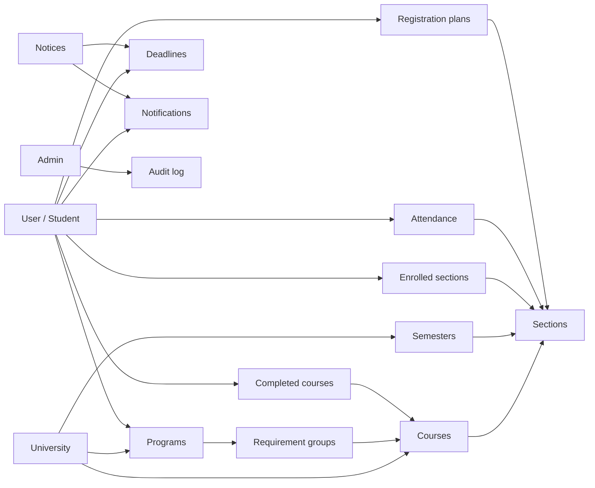

# FRIDAY: Database Design

**Companion to:** `prd.md`, `tech-stack.md`, `app-flow.md`, `design-guide.md`
**Date:** October 21, 2026
**Database:** PostgreSQL (Neon or Supabase), accessed through Prisma
**Purpose:** Define what data FRIDAY saves, why, and how every table connects.

---

## 1. Big Picture

FRIDAY stores four kinds of data:

| Kind | Examples | Who creates it |
|---|---|---|
| **University data** (shared by everyone) | Programs, courses, prerequisites, sections, exams, notices, university deadlines | Admins (or CSV import) |
| **Student data** (private to one student) | Profile, completed courses, current classes, personal deadlines, attendance, saved plans, preferences | The student |
| **Derived / system data** | Notifications, AI extraction results, read receipts, graduation estimates | The system |
| **Security / operational data** | Sessions, verification tokens, audit logs, import jobs | The system |

**How it connects, in one sentence:**
A **University** has **Programs**, **Courses**, and **Semesters**; Courses have **Sections** (class times); a **Student** (a User) belongs to a Program, has **Completed Courses** and **Enrolled Sections**, and receives **Notices**, **Deadlines**, and **Notifications**; **Admins** create the university data and every admin change goes into the **Audit Log**.

---

## 2. Entity Relationship Diagram

```mermaid
erDiagram
    UNIVERSITY ||--o{ USER : has
    UNIVERSITY ||--o{ PROGRAM : offers
    UNIVERSITY ||--o{ COURSE : lists
    UNIVERSITY ||--o{ SEMESTER : runs
    UNIVERSITY ||--o{ NOTICE : publishes

    USER ||--o| STUDENT_PROFILE : "is (if student)"
    USER ||--o{ SESSION : opens
    USER ||--o{ NOTIFICATION : receives
    USER ||--o| NOTIFICATION_PREFERENCE : sets
    USER ||--o{ AUDIT_LOG : "performs (if admin)"

    PROGRAM ||--o{ STUDENT_PROFILE : enrolls
    PROGRAM ||--o{ REQUIREMENT_GROUP : defines
    REQUIREMENT_GROUP ||--o{ REQUIREMENT_GROUP_COURSE : contains
    COURSE ||--o{ REQUIREMENT_GROUP_COURSE : "counts toward"

    COURSE ||--o{ PREREQUISITE_GROUP : "has requirements"
    PREREQUISITE_GROUP ||--o{ PREREQUISITE_ITEM : "lists options"
    COURSE ||--o{ PREREQUISITE_ITEM : "is required by"

    COURSE ||--o{ SECTION : "offered as"
    SEMESTER ||--o{ SECTION : contains
    INSTRUCTOR ||--o{ SECTION : teaches
    SECTION ||--o{ SECTION_MEETING : "meets at"
    SECTION ||--o{ EXAM : "has"

    STUDENT_PROFILE ||--o{ COMPLETED_COURSE : finished
    COURSE ||--o{ COMPLETED_COURSE : "is taken as"
    STUDENT_PROFILE ||--o{ ENROLLED_SECTION : "attends"
    SECTION ||--o{ ENROLLED_SECTION : "has students"
    ENROLLED_SECTION ||--o{ ATTENDANCE_RECORD : tracks

    STUDENT_PROFILE ||--o{ REGISTRATION_PLAN : saves
    REGISTRATION_PLAN ||--o{ REGISTRATION_PLAN_ITEM : contains
    SECTION ||--o{ REGISTRATION_PLAN_ITEM : "is chosen in"

    NOTICE ||--o{ NOTICE_TARGET : "is aimed at"
    NOTICE ||--o| NOTICE_EXTRACTION : "analyzed as"
    NOTICE ||--o{ NOTICE_READ : "is read by"
    NOTICE ||--o{ DEADLINE : "creates"
    USER ||--o{ NOTICE_READ : reads

    USER ||--o{ DEADLINE : "owns (personal)"
    DEADLINE ||--o{ DEADLINE_USER_STATE : "tracked per student"
    USER ||--o{ DEADLINE_USER_STATE : tracks
    DEADLINE ||--o{ REMINDER : schedules

    USER ||--o{ ASSISTANT_CONVERSATION : starts
    ASSISTANT_CONVERSATION ||--o{ ASSISTANT_MESSAGE : contains
    USER ||--o{ IMPORT_JOB : "runs (if admin)"
```

---

## 3. Tables: What Is Saved

Conventions: every table has `id` (UUID), `created_at`, `updated_at`. Tables owned by a university also carry `university_id` (multi-tenant ready). `PK` = primary key, `FK` = foreign key.

### 3.1 Identity and Access

#### `universities`
| Column | Notes |
|---|---|
| `name`, `short_name` | e.g. display name |
| `email_domain` | Used to verify student emails |
| `timezone` | e.g. `Asia/Dhaka` |
| `settings` (JSON) | Credit rules, attendance threshold, grading scale |

#### `users`
One row per login (students and admins).
| Column | Notes |
|---|---|
| `university_id` FK → universities | |
| `role` | `student`, `admin`, `super_admin` |
| `email` (unique per university) | |
| `password_hash` | argon2id, never plain text |
| `full_name` | |
| `email_verified_at` | Null = cannot log in |
| `status` | `active`, `deactivated`, `locked` |
| `failed_login_count`, `locked_until` | Supports the 5-attempt lockout |
| `last_login_at` | |

#### `sessions`
| Column | Notes |
|---|---|
| `user_id` FK | |
| `token_hash` | Hashed session token |
| `expires_at`, `ip`, `user_agent` | Shows "active sessions" in settings |

#### `verification_tokens`
| Column | Notes |
|---|---|
| `user_id` FK, `type` (`email_verify`, `password_reset`, `admin_invite`) | |
| `token_hash`, `expires_at`, `used_at` | Single-use, expiring |

#### `student_profiles`
Extra data that only students have (1-to-1 with `users`).
| Column | Notes |
|---|---|
| `user_id` FK (unique) | |
| `student_id_number` | University ID (unique per university) |
| `program_id` FK → programs | |
| `current_semester_id` FK → semesters | |
| `intake_semester_id` FK | When they started |
| `onboarding_completed_at` | Drives the onboarding redirect |
| `max_credits_per_semester` | Used by graduation planner |

### 3.2 University Catalog (Admin-Managed)

#### `programs`
`university_id`, `name`, `code`, `total_credits_required`, `min_credits_per_semester`, `max_credits_per_semester`.

#### `requirement_groups`
Parts of a degree (core, major, electives).
`program_id` FK, `name`, `credits_required`, `min_courses`.

#### `requirement_group_courses`
Join table: which courses count toward which group.
`requirement_group_id` FK, `course_id` FK. PK = both columns.

#### `courses`
`university_id`, `code` (unique per university, e.g. `CSE321`), `title`, `credits`, `description`, `department`, `is_active`.

#### `prerequisite_groups` + `prerequisite_items`
Supports "A AND (B OR C)".
- `prerequisite_groups`: `course_id` FK, `group_index`. Each *group* is an AND requirement.
- `prerequisite_items`: `group_id` FK, `required_course_id` FK, `min_grade` (optional). Each *item inside a group* is an OR option.

> Example: CSE340 needs CSE220 **and** (MAT120 **or** MAT110) → two groups; the second has two items.

#### `semesters`
`university_id`, `name` (e.g. `Fall 2026`), `start_date`, `end_date`, `registration_opens_at`, `registration_closes_at`, `withdrawal_deadline`, `is_current`.

#### `instructors`
`university_id`, `name`, `initials`, `email` (optional), `department`.

#### `sections`
One offering of a course in one semester.
| Column | Notes |
|---|---|
| `course_id`, `semester_id`, `instructor_id` FKs | |
| `section_number` | e.g. `23` |
| `capacity`, `seats_available` | |
| `room` | |
| `seats_updated_at` | Powers the "last updated" label |

#### `section_meetings`
A section can meet several times a week.
`section_id` FK, `day_of_week`, `start_time`, `end_time`, `room` (override), `type` (`lecture`, `lab`).

#### `exams`
`section_id` FK, `type` (`midterm`, `final`, `quiz`), `starts_at`, `ends_at`, `room`.

### 3.3 Student Academic Data

#### `completed_courses`
What the student has already finished (used for prerequisites and degree progress).
`student_profile_id` FK, `course_id` FK, `semester_id` FK (optional), `grade` (optional), `credits_earned`, `status` (`completed`, `withdrawn`, `failed`). Unique on (`student_profile_id`, `course_id`, `semester_id`).

#### `enrolled_sections`
The classes the student is currently taking. This powers the schedule, dashboard, and attendance.
`student_profile_id` FK, `section_id` FK, `status` (`enrolled`, `withdrawn`), `enrolled_at`.

#### `attendance_records`
`enrolled_section_id` FK, `class_date`, `status` (`attended`, `missed`, `cancelled`), `note`. Unique on (`enrolled_section_id`, `class_date`).

#### `registration_plans`
Plans generated by the Copilot.
`student_profile_id` FK, `semester_id` FK, `name` (Plan A/B/C or custom), `total_credits`, `conflict_count`, `score`, `preferences` (JSON: gaps, free days, instructors), `is_saved`.

#### `registration_plan_items`
`plan_id` FK, `section_id` FK, `course_id` FK. Unique on (`plan_id`, `course_id`).

### 3.4 Notices and Deadlines

#### `notices`
| Column | Notes |
|---|---|
| `university_id`, `author_id` FK → users | Admin who posted |
| `title`, `body`, `attachments` (JSON of file URLs) | |
| `category` | `registration`, `exam`, `tuition`, `scholarship`, `holiday`, `academic`, `administrative`, `emergency` |
| `importance` | `normal`, `high`, `emergency` |
| `status` | `draft`, `review`, `published`, `archived` |
| `published_at` | |
| `search_vector` | `tsvector` for full-text search |

#### `notice_targets`
Who a notice is aimed at. No rows = everyone.
`notice_id` FK, `target_type` (`program`, `semester`, `course`, `section`), `target_id`.

#### `notice_extractions`
The AI's output for a notice (kept so admins can review and corrections are traceable).
`notice_id` FK (unique), `suggested_category`, `extracted_dates` (JSON), `confidence`, `model_name`, `status` (`pending_review`, `approved`, `corrected`), `reviewed_by` FK, `reviewed_at`.

#### `notice_reads`
`notice_id` FK, `user_id` FK, `read_at`. Drives the unread badge.

#### `deadlines`
Both university and personal deadlines live in one table.
| Column | Notes |
|---|---|
| `university_id` | |
| `scope` | `university` or `personal` |
| `owner_user_id` FK | Set only for personal deadlines |
| `notice_id` FK (nullable) | Links to the notice it came from |
| `course_id` FK (nullable) | |
| `target_type`, `target_id` | Same targeting idea as notices (e.g. a program) |
| `title`, `description` | |
| `due_at` | |
| `priority` | `low`, `medium`, `high` |
| `status` | For personal deadlines: `open`, `done` |

#### `deadline_user_states`
Each student's own view of a **university** deadline (they cannot edit it, but can complete, snooze, or hide it).
`deadline_id` FK, `user_id` FK, `status` (`open`, `done`), `snoozed_until`, `hidden`. Unique on (`deadline_id`, `user_id`).

#### `reminders`
Scheduled alerts for a deadline.
`deadline_id` FK, `user_id` FK, `remind_at`, `sent_at`. Unique on (`deadline_id`, `user_id`, `remind_at`) to prevent duplicates.

### 3.5 Notifications and Preferences

#### `notifications`
`user_id` FK, `type` (`deadline_reminder`, `notice`, `schedule_change`, `attendance_warning`, `registration`), `title`, `body`, `link` (deep link), `entity_type`, `entity_id`, `channel` (`in_app`, `email`), `read_at`, `sent_at`, `dedupe_key` (unique).

#### `notification_preferences`
`user_id` FK (unique), `email_enabled`, `in_app_enabled`, `categories` (JSON), `reminder_offsets` (e.g. `[4320, 1440, 120]` minutes), `digest_enabled`, `quiet_hours` (JSON). *Emergency notices ignore these settings.*

### 3.6 AI Assistant

#### `assistant_conversations`
`user_id` FK, `title`, `last_message_at`.

#### `assistant_messages`
`conversation_id` FK, `role` (`user`, `assistant`), `content`, `sources` (JSON of record references), `tool_calls` (JSON, redacted), `created_at`.

### 3.7 Admin and Operations

#### `audit_logs`
`admin_user_id` FK, `action` (`create`, `update`, `delete`, `publish`, `deactivate`), `entity_type`, `entity_id`, `changes` (JSON before/after), `ip`, `created_at`. Append-only.

#### `import_jobs`
`admin_user_id` FK, `type` (`courses`, `sections`, `students`), `file_url`, `status` (`validating`, `failed`, `ready`, `completed`), `total_rows`, `error_rows`, `error_report_url`.

---

## 4. How the Pieces Connect (By Feature)

| Feature | Data it reads | Data it writes |
|---|---|---|
| **Login / signup** | `users`, `sessions`, `verification_tokens` | `users`, `sessions`, `verification_tokens` |
| **Onboarding** | `programs`, `semesters`, `courses` | `student_profiles`, `completed_courses`, `notification_preferences` |
| **Dashboard** | `enrolled_sections` → `sections` → `section_meetings`; `deadlines`; `notices`; `attendance_records` | none |
| **Schedule** | `enrolled_sections`, `sections`, `section_meetings`, `exams`, `semesters` | none |
| **Deadline Manager** | `deadlines`, `deadline_user_states` | `deadlines` (personal), `deadline_user_states`, `reminders` |
| **Notices** | `notices`, `notice_targets`, `notice_reads` | `notice_reads` |
| **Degree progress** | `student_profiles` → `programs` → `requirement_groups` → `courses`; `completed_courses`; `prerequisite_*` | none (computed on the fly; may cache) |
| **Registration Copilot** | `completed_courses`, `prerequisite_*`, `sections`, `section_meetings`, `instructors` | `registration_plans`, `registration_plan_items` |
| **Attendance** | `enrolled_sections`, `attendance_records`, `universities.settings` (threshold) | `attendance_records` |
| **Assistant** | Same tables as above via data tools (current student only) | `assistant_conversations`, `assistant_messages` |
| **Admin: catalog** | all catalog tables | catalog tables, `audit_logs`, `import_jobs` |
| **Admin: notices** | `notices`, `notice_extractions` | `notices`, `notice_targets`, `notice_extractions`, `deadlines`, `notifications`, `audit_logs` |

### 4.1 Key Connected Flows

**A. Admin publishes a notice with a deadline**
1. Admin inserts `notices` (draft) + `notice_targets`.
2. AI creates `notice_extractions` (e.g. withdrawal deadline = Oct 15).
3. Admin approves → `notices.status = published`.
4. System creates a `deadlines` row (`scope = university`, `notice_id` set).
5. System resolves the audience (students matching the targets) and creates `reminders` and `notifications`.
6. `audit_logs` records the publish.

**B. Section time changes**
1. Admin updates `section_meetings` → `audit_logs` row.
2. System finds all `enrolled_sections` for that section.
3. Creates a `notifications` row per affected student (`type = schedule_change`).
4. Student's schedule shows the new time automatically, since it reads from `section_meetings`.

**C. Registration plan generation**
1. Student picks courses → system reads `completed_courses` and `prerequisite_*` to check eligibility.
2. Reads `sections` + `section_meetings` for the chosen semester.
3. Solver finds conflict-free combinations.
4. Results saved as `registration_plans` + `registration_plan_items`.

**D. Attendance warning**
1. Student logs a miss → `attendance_records`.
2. System counts missed vs total classes for that `enrolled_section`, compares with the threshold in `universities.settings`.
3. If close to the limit → `notifications` row (`attendance_warning`).

**E. Degree progress (computed, not stored)**
`student_profiles.program_id` → `requirement_groups` → `requirement_group_courses`, compared against `completed_courses` (and `enrolled_sections` for "in progress"). Credits remaining = required − earned. Graduation estimate simulates future semesters using prerequisites and `max_credits_per_semester`.

---

## 5. Relationship Rules and Delete Behavior

| Relationship | On delete |
|---|---|
| `users` → `student_profiles`, `sessions`, `notifications`, personal `deadlines`, `attendance`, `plans`, `assistant_*` | **Cascade** (account deletion removes personal data) |
| `courses` → `sections` | **Restrict** (cannot delete a course that has sections; deactivate instead) |
| `sections` → `enrolled_sections` | **Restrict** (soft-delete / mark cancelled) |
| `notices` → `deadlines` | **Set null** on `notice_id` (deadline stays if notice is archived/deleted) |
| `notices` → `notice_reads`, `notice_targets`, `notice_extractions` | **Cascade** |
| `users` (admin) → `audit_logs` | **Restrict**; deactivate admins rather than deleting |
| `programs` → `student_profiles` | **Restrict** |

**Soft delete** (`deleted_at`) is used for `courses`, `programs`, `notices`, `users` so history and references stay intact. Hard delete is used only for personal data when a student requests account deletion.

---

## 6. Indexes and Constraints

| Purpose | Index / constraint |
|---|---|
| Unique login | `users (university_id, email)` unique |
| Unique student ID | `student_profiles (student_id_number)` unique per university |
| Course lookup | `courses (university_id, code)` unique |
| Section lookup | `sections (semester_id, course_id)`; `sections (instructor_id)` |
| Schedule rendering | `enrolled_sections (student_profile_id, status)`; `section_meetings (section_id, day_of_week)` |
| Deadline views | `deadlines (owner_user_id, due_at)`; `deadlines (university_id, scope, due_at)` |
| Notifications | `notifications (user_id, read_at, created_at DESC)`; unique `dedupe_key` |
| Unread notices | `notice_reads (user_id, notice_id)` unique |
| Full-text search | GIN on `notices.search_vector`; GIN trigram (`pg_trgm`) on `courses.code`, `courses.title` |
| Prevent duplicate reminders | unique `(deadline_id, user_id, remind_at)` |
| Data sanity | `CHECK (end_time > start_time)`, `CHECK (credits BETWEEN 1 AND 6)`, `CHECK (capacity >= 0)`, `CHECK (seats_available BETWEEN 0 AND capacity)` |
| Personal deadline ownership | `CHECK (scope <> 'personal' OR owner_user_id IS NOT NULL)` |

---

## 7. Sensitive Data, Privacy, and Retention

| Data | Protection |
|---|---|
| Passwords | argon2id hash only |
| Session / verification tokens | Stored hashed, expiring, single-use where applicable |
| Student academic data | Accessible only by that student and authorized admins; enforced in service-layer policies (and Postgres row-level security if on Supabase) |
| AI assistant logs | Stored per user; sensitive fields redacted in `tool_calls`; deletable by the user |
| Uploaded files (imports, later documents) | Object storage with signed, expiring URLs; never public |
| Audit logs | Append-only, retained for compliance |

**Retention (suggested)**
| Data | Keep |
|---|---|
| Sessions | Until expiry + 30 days |
| Verification tokens | 7 days after expiry |
| Notifications | 12 months |
| Assistant messages | 12 months or until the user deletes them |
| Audit logs | 3 years |
| Import jobs and error reports | 90 days |
| Account data after deletion request | Purged within 30 days |

**Never stored:** plain passwords, card numbers or bank account details, or government ID numbers. (Payments, when added, use a hosted gateway, and FRIDAY keeps only a transaction reference and status.)

---

## 8. Future Tables (Phases 3–4, Not in MVP)

| Module | Tables |
|---|---|
| **Career hub** | `opportunities` (internship/job/scholarship/competition), `opportunity_skills`, `student_skills`, `saved_opportunities`, `applications` |
| **Document vault** | `documents` (type, file_url, expires_at), `document_checklists` linked to `opportunities` |
| **CV / portfolio** | `cvs`, `cv_sections`, `portfolio_items` |
| **Study / expenses** | `study_sessions`, `expenses`, `expense_categories` |
| **Commute / carpool** | `commute_profiles`, `carpool_requests`, `carpool_matches` |
| **Marketplace** | `listings`, `listing_images`, `service_offers`, `orders`, `payments` (gateway reference only), `reviews` |
| **Payments** | `fee_schedules`, `fee_payments` (status + gateway transaction id) |

Each new table follows the same pattern: `university_id` for multi-tenancy, `user_id` ownership, and a clear delete rule.

---

## 9. Seed Data Needed for Launch

1. One `university` record with its email domain and settings.
2. Programs with requirement groups.
3. Course catalog with prerequisites.
4. Current and upcoming `semesters`.
5. `instructors` and `sections` with `section_meetings` (via CSV import).
6. A super-admin `user` and the first admin accounts.

---

## 10. Open Database Questions

1. Will students enter completed courses manually, or will a transcript import populate `completed_courses`?
2. Should `enrolled_sections` be entered by the student, or synced from an official data source?
3. Do you need to store grades (for CGPA calculation) in the MVP, or only completed/not completed?
4. Should multiple universities share one database (tenant column) or use separate databases?
5. How long should assistant chat history be kept by default?
